# EPIC-001 — Matriz de Dependências entre Stories

> **Última atualização:** 2026-04-29
> **Autor:** Morgan (PM)

---

## Visão Geral

23 stories distribuídas em 4 fases lógicas + 1 story de saldo. Não há ordem temporal rígida (cadência diária permite reordenação), mas há dependências hard (gates) que precisam ser respeitadas.

---

## Diagrama de Dependências (Mermaid)

```mermaid
graph TD
    %% Fase 1 — Fundação
    S11[1.1 parametros_sistema] --> S15[1.5 CI janela restrita]
    S11 --> S33[3.3 Audit log universal]

    S12[1.2 Tx vendas + Tiny] --> S34[3.4 Fila retry exponencial]

    S13[1.3 useAuth React Query] --> S26[2.6 12 E2E críticos]
    S13 --> S32[3.2 Versioning]

    S14[1.4 Wrapper Zod] --> S22[2.2 Cobertura Vendas]
    S14 --> S23[2.3 Cobertura PCP+Estoque]
    S14 --> S24[2.4 Cobertura Protocolo+Crediário]
    S14 --> S32
    S14 --> S33
    S14 --> S42[4.2 OpenAPI]

    S15 --> S21[2.1 Setup teste prod GATE]
    S15 --> S41[4.1 Schema spec]

    S16[1.6 Drift Directus]

    %% Fase 2 — Pirâmide de Testes
    S21 -.GATE.-> S22
    S21 -.GATE.-> S23
    S21 -.GATE.-> S24
    S21 -.GATE.-> S26

    S25[2.5 Setup Playwright] --> S26

    %% Fase 3 — Refatoração + Blindagem
    S31[3.1 Caça erros silenciados] --> S32

    S35[3.5 Guard fn_fechamento_dist]
    S36[3.6 Unificar dupla-entrada]

    %% Fase 4 — Documentação
    S43[4.3 10 ADRs]
    S44[4.4 8 Runbooks]
    S45[4.5 Atualizar docs] -.- S46

    S46[4.6 Auditoria final]

    %% Saldo débito
    S47[4.7 Banco teste real - SALDO]

    %% Auditoria depende de tudo
    S22 --> S46
    S23 --> S46
    S24 --> S46
    S26 --> S46
    S31 --> S46
    S32 --> S46
    S33 --> S46
    S34 --> S46
    S35 --> S46
    S36 --> S46
    S41 --> S46
    S42 --> S46
    S43 --> S46
    S44 --> S46
    S45 --> S46
    S46 --> S47

    %% Styles
    classDef gate fill:#ff6b6b,stroke:#c92a2a,color:#fff
    classDef p0 fill:#ffd43b,stroke:#fab005
    classDef p1 fill:#a5d8ff,stroke:#1971c2
    classDef p2 fill:#d3f9d8,stroke:#2f9e44

    class S21,S15 gate
    class S11,S12,S13,S14,S35,S46,S47 p0
    class S16,S22,S23,S24,S25,S26,S31,S32,S33,S34,S41,S42,S43,S44 p1
    class S36,S45 p2
```



---

## Tabela de Dependências (legível)

| Story | Depende de | Bloqueia |
|-------|-----------|----------|
| **1.1** parametros_sistema | — | 1.5, 3.3 |
| **1.2** Tx vendas + Tiny | — | 3.4 |
| **1.3** useAuth React Query | — | 2.6, 3.2 |
| **1.4** Wrapper Zod | — (Zod já instalado) | 2.2, 2.3, 2.4, 3.2, 3.3, 4.2 |
| **1.5** CI janela restrita | 1.4 (recomendado) | 2.1, 4.1 |
| **1.6** Drift Directus | 1.5 (notificação) | — |
| **2.1** Setup teste prod (GATE) | 1.5 | **TODAS as 2.x e dependentes** |
| **2.2** Cobertura Vendas | 1.4, 2.1 | 4.6 |
| **2.3** Cobertura PCP+Estoque | 1.1, 1.4, 2.1 | 4.6 |
| **2.4** Cobertura Protocolo+Crediário | 1.1, 1.4, 2.1 | 4.6 |
| **2.5** Setup Playwright | 2.1, 1.5 | 2.6 |
| **2.6** 12 E2E críticos | 2.1, 2.5, 1.3 | 4.6 |
| **3.1** Caça erros silenciados | — | 3.2 (toast usado em 409) |
| **3.2** Versioning concorrência | 1.3, 1.4, 2.1, 3.1 | 4.6 |
| **3.3** Audit log universal | 1.4 | 4.6 |
| **3.4** Fila retry exponencial | 1.2 | 4.6 |
| **3.5** Guard fn_fechamento_dist | — | 4.6 |
| **3.6** Unificar dupla-entrada | — | 4.6 |
| **4.1** Schema spec auto-gerado | 1.5 | 4.6 |
| **4.2** OpenAPI from Zod | 1.4 | 4.6 |
| **4.3** 10 ADRs | Stories que cada ADR documenta | 4.6 |
| **4.4** 8 Runbooks | Vários (rascunhos) | 4.6 |
| **4.5** Atualizar docs | TODAS anteriores | 4.6 |
| **4.6** Auditoria final | TODAS as 22 anteriores | EPIC fechado |
| **4.7** Banco teste real (SALDO) | 4.6 (paralelo) | Fechamento definitivo |

---

## Gates Críticos

### Gate 1 — Story 2.1 (Setup teste em produção)

**Por quê:** todas as stories de cobertura (2.2, 2.3, 2.4, 2.6) precisam do `withTestTx` e do schema isolado. Sem esta story, escrever testes integration é violação direta da mitigação §3.4 do plano.

**Implicação:** ordem rígida — Story 2.1 ANTES de qualquer 2.x.

### Gate 2 — Story 1.5 (CI janela restrita)

**Por quê:** sem CI configurado, testes integration não rodam em janela noturna. Se rodassem em horário comercial, M4 violada.

**Implicação:** Story 1.5 antes de Story 2.1.

### Gate 3 — Story 4.6 (Auditoria final)

**Por quê:** EPIC só fecha após auditoria. Auditoria precisa de todas 22 stories anteriores Done.

**Implicação:** ordem rígida no final — 4.6 é última (exceto 4.7 que pode rodar em paralelo).

---

## Stories paralelas (sem dependência hard)

Estas podem rodar em paralelo entre si:

- **Pacote A (fundação independente):** 1.1, 1.2, 1.3 (cada um resolve um problema crítico isolado)
- **Pacote B (refatoração isolada):** 3.5, 3.6 (não dependem de 1.x)
- **Pacote C (cobertura paralela):** 2.2, 2.3, 2.4 (após 2.1, podem rodar simultaneamente)

---

## Ordem sugerida (caminho crítico)

```
Dia 1: 1.1, 1.2 (parcial), 1.3 (mini), 3.5, 3.1 (parcial), 3.3 (parcial)
       [Pacote Dia 1 do plano §11.2]

Dia 2-3: 1.4 (Zod wrapper) — gate de várias outras

Dia 4: 1.5 (CI) — gate de testes

Dia 5: 1.6 (Drift Directus) — independente

Dia 6-7: 2.1 (Setup teste em produção) — GATE CRÍTICO

Dia 8-11: 2.2, 2.3, 2.4 em paralelo (3 devs ou 1 dev por dia)

Dia 12-13: 2.5 (Playwright) + 3.6 (Unificar)

Dia 14-18: 2.6 (12 E2E)

Dia 19-22: 3.2, 3.3 (full), 3.4 (full), 3.1 (full)

Dia 23-25: 4.1, 4.2 (paralelo)

Dia 26-28: 4.3, 4.4, 4.5

Dia 29-30: 4.6 (auditoria) + 4.7 paralelo

Dia 31-33: 4.7 saldo
```

**Estimativa total:** ~30 dias úteis se ritmo cadência diária se mantiver. Pode reduzir para ~20 dias com mais paralelismo.

---

## Pacote Dia 1 detalhado

Conforme plano §11.2:

| Story | Parcial? | Tempo | Owner |
|-------|----------|-------|-------|
| 1.1 — parametros_sistema | Completa | 3h | Backend |
| 1.2 — Tx vendas (não inclui sync Tiny ainda) | Parcial | 1h | Backend |
| 1.2 — Fila básica + sync Tiny | Parcial | 2h | Backend |
| 1.3 — TTL useAuth (sem React Query ainda) | Mini | 1h | Frontend |
| 3.5 — Guard fn_fechamento_dist | Completa | 1h | Backend (banco) |
| 3.1 — Caça catches (parcial: top 5 casos) | Parcial | 1.5h | Frontend |
| 3.3 — Audit log nas 5 rotas críticas | Parcial | 1.5h | Backend |

**Total Dia 1:** ~11h.
**Stories completadas no Dia 1:** 1.1, 3.5 (2 das 23).
**Stories iniciadas mas não completas:** 1.2, 1.3, 3.1, 3.3 (4 das 23).

Dia 2 continua de onde Dia 1 parou.
